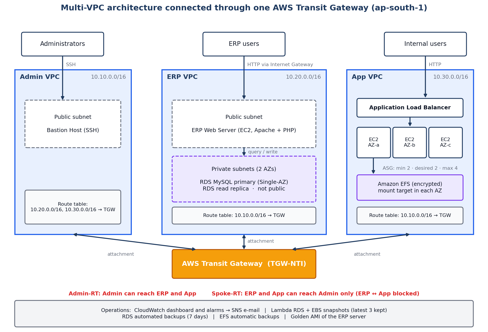
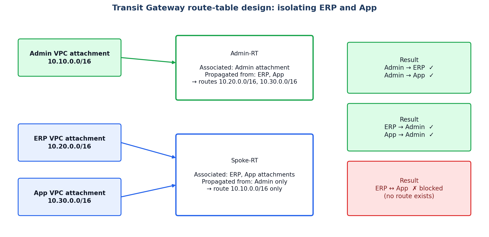

# Cloud Infrastructure for a Startup Company on AWS

A multi-VPC AWS environment for a startup with three teams (Admin, ERP, App), connected through a single **AWS Transit Gateway**, in `ap-south-1` (Mumbai). It hosts a multi-tier ERP system and a highly available internal application, with monitoring and disaster recovery.

**Full write-up:** [`report/AWS_Startup_Infrastructure_Transit_Gateway.pdf`](report/AWS_Startup_Infrastructure_Transit_Gateway.pdf)

## Highlights

- **Three isolated VPCs** (Admin `10.10.0.0/16`, ERP `10.20.0.0/16`, App `10.30.0.0/16`) joined by one Transit Gateway instead of a peering mesh.
- **ERP / App isolation with two TGW route tables.** `Admin-RT` lets Admin reach both; `Spoke-RT` lets ERP and App reach Admin only, so ERP and App cannot reach each other.
- **ERP system (multi-tier):** EC2 web tier (Apache + PHP) in a public subnet, RDS MySQL in private subnets, plus an RDS read replica.
- **Internal application (HA):** Application Load Balancer, Auto Scaling Group (min 2, max 4, 3 AZs), shared documents on encrypted Amazon EFS.
- **Monitoring:** CloudWatch dashboard and alarms, SNS e-mail notifications.
- **Disaster recovery:** RDS automated backups (7 days), Lambda-driven RDS and EBS snapshots (latest 3 kept), EFS backups, Golden AMI.
- **Secure admin access:** Bastion Host in the Admin VPC, IAM groups per team, MFA for privileged users, security groups.

## Transit Gateway routing

## Cost trade-off

A Transit Gateway is billed per attachment-hour plus per GB processed, so it is the largest fixed cost of this design. It was chosen for central routing control and scalability; for a fixed set of three low-traffic VPCs, VPC Peering would be cheaper. Details and an estimate are in section 10 of the report (verify current `ap-south-1` rates before budgeting).

## Evidence

Screenshots from the AWS Console and e-mail notifications are in [`images/evidence`](images/evidence). Account identifiers were redacted.

## Production improvements

RDS Multi-AZ, private application subnets behind NAT, HTTPS with ACM, Secrets Manager, Session Manager instead of a Bastion Host, EventBridge-scheduled backups with cross-region copies, and Infrastructure as Code (Terraform or CloudFormation).

## Author

Ziad Nady
